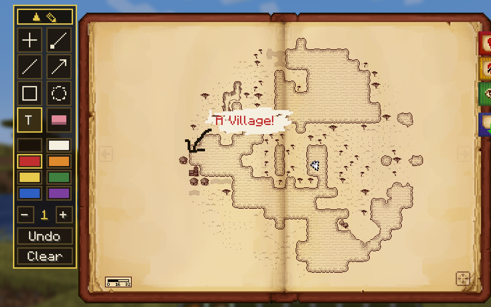
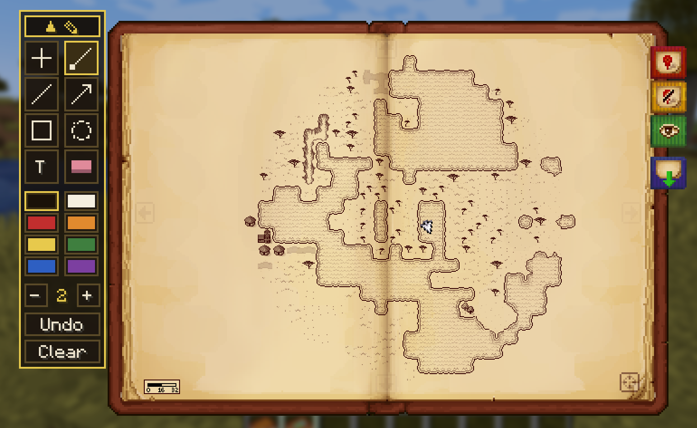
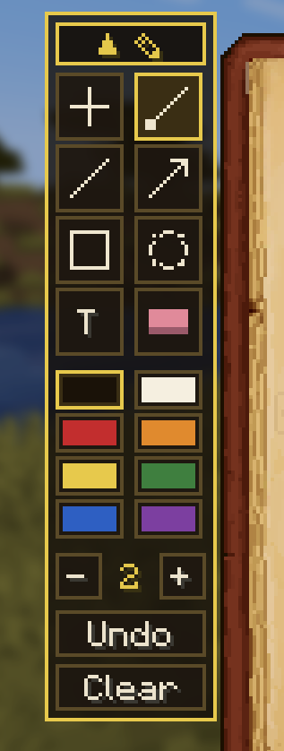
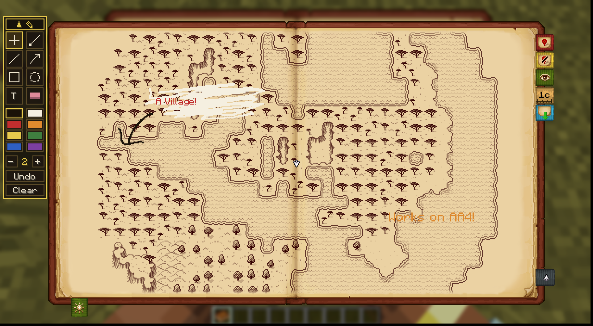

# Here Be Doodles

**Draw anything on your Antique Atlas.**
Minecraft 1.21.1 · NeoForge · client-side · modid `herebedoodles` · by Barunn

Old charts warned of the unknown with *"here be dragons"*. Yours can say whatever you want. Here Be Doodles turns the Antique Atlas book into a drawing surface: a grease-pencil kit riding on top of the map, with every mark glued to the terrain it was drawn over.



Plan routes, circle ruins, mark a friend's embarrassing death spot, box out a future build site, or scrawl "DO NOT DIG" over the cave that had the warden in it. The map keeps up: marks live in world coordinates, so they pan and zoom with the atlas instead of floating over it.

## The kit

A collapsible toolbar sits beside the open book. Click the little ✎ tab to fold it away whenever you just want the map.



| Tool | What it does |
|---|---|
| **Hand** | Puts the pencil down. Panning, zooming, and the atlas's own markers work exactly as before |
| **Pen** | Freehand grease pencil |
| **Line** | A single straight line, dragged point to point |
| **Arrow** | A line with a fat arrowhead on the end you release |
| **Box** | A rectangle, dragged corner to corner |
| **Circle** | A ring, dragged from centre to edge |
| **Text** | Click the map, type your label, press **Enter** (Esc cancels) |
| **Eraser** | Rubs out whatever passes under it |

Below the tools: **eight ink colours**, a **brush size** stepper (1-6, sets line thickness and text size), **Undo** (also **Ctrl+Z**), and **Clear** for the whole dimension.



**Right-click** backs out one step: it drops the mark you are mid-drawing, or puts the pencil down if you weren't drawing.

## Your notes, your machine

Doodles are drawn and saved on **your side only**, per world and per dimension; singleplayer saves and each multiplayer server keep separate notebooks. Nothing is sent anywhere, servers never need the mod installed, and it works on any server, vanilla ones included.

Saves live at `<your game folder>/herebedoodles/` as one small file per dimension. Delete a file, and that dimension's notes are gone; copy them to another computer, and your notes come along.

## Big book (experimental)

An optional config toggle grows the atlas book to fill the window, the way Antique Atlas 4's did:

```toml
# config/herebedoodles-client.toml
[book]
bigBook = true
```

It is **off by default** while it earns trust. Doodling works the same at either size.

## Requirements

| Mod | Why |
|---|---|
| An Antique Atlas, pick one | The book all of this draws on |
| [Antique Atlas Neoforge](https://www.curseforge.com/minecraft/mc-mods/antique-atlas-neoforge) (Antique Atlas 4, modid `antique_atlas`) | Supported from 1.1.0, NeoForge 1.21.1. Needs Surveyor Neoforge |
| [Antique Atlas 8](https://www.curseforge.com/minecraft/mc-mods/antique-atlas) (modid `antiqueatlas`) | NeoForge 1.21.1 or Forge 1.20.1. Needs UnionLib |



Client only: install it on your own game. Servers need nothing.

## Supported versions

| Loader | Minecraft | Mod version |
|---|---|---|
| NeoForge | 1.21.1 | 0.1.0 |

---

*Part of The Warborn Realm, by barunn*

License: All Rights Reserved.
